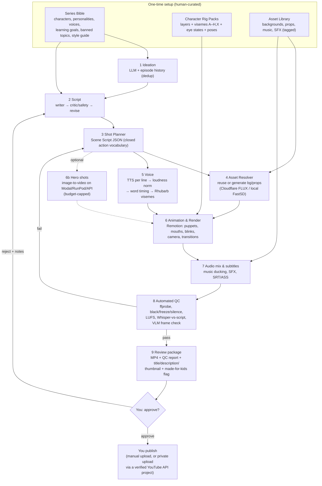

# Automated AI Kids' Animation: Research and Architecture Report

**Status:** Research phase only. Nothing has been installed or implemented yet.
**Date of research:** 29 October 2026
**Scope:** Find the cheapest realistic way to turn an idea into a finished, ready-to-review children's animated video, where the owner's only manual step is approving and publishing.

> **How to read the evidence.** Facts marked ✅ were checked against the project's own page (GitHub README, Hugging Face model card, or vendor docs) during this research. Facts marked ⚠️ come from third-party trackers or blogs, or from sources that disagree with each other. Treat those as estimates to re-check before spending money. Cost figures marked *(est.)* are my own arithmetic from the stated assumptions.

---

## 0. Executive summary

1. **Full end-to-end automation is achievable, but only for a specific style.** The style is **2D "cut-out" (puppet) animation driven by code**: reusable character rigs, a library of backgrounds, AI voices, automatic lip-sync from visemes, and programmatic camera moves and transitions. This is how many low-budget kids' channels are already made. It runs on your laptop's CPU, keeps characters 100% consistent (every frame is drawn from the same art), and costs about **$0–$1 per 5-minute episode**.
2. **Fully generative AI video (Wan, LTX, Kling, Veo, Seedance) is not a good backbone for this budget.** It costs roughly **$30–$300 per 5-minute episode** through APIs once retakes are included (⚠️ est.), or many GPU-hours if self-hosted. It needs an NVIDIA GPU that your laptop doesn't have. It still drifts on character identity across many shots and needs a lot of human curation. The open-source "idea → drama" projects (ViMax, Toonflow, huobao-drama) are real and popular, but they are thin layers over these paid video APIs.
3. **Recommended: a hybrid, built in phases.** Build the cut-out pipeline first. It's cheap, deterministic, and fully automatable. Later, add an *optional* module that uses AI image-to-video for a few "hero shots" per episode, rendered on a rented GPU or via API under a fixed per-episode budget cap.
4. **The real costs are setup time and platform policy, not money.** Designing and rigging the recurring characters takes 1–3 weeks of part-time curation up front. YouTube's July 2025 "inauthentic content" rule explicitly names *"AI-generated content made with generic or unoriginal templates"* and *"characters put in the same situation over and over with the same outcome"* (✅). A template pipeline must therefore be designed for story variety, or the channel risks demonetisation. The output also faces growing public scrutiny of AI kids' content (§6).

---

## 1. Feasibility

### 1.1 What is realistically achievable

| Target | Achievable on a ~$0–$50/month budget? | Notes |
|---|---|---|
| Original, age-appropriate story ideas and scripts | **Yes, fully automated** | LLMs do this well. Cost is cents per episode. A critic/revision pass and a human check are still advisable for child safety. |
| Scene breakdown with shot lists, actions, dialogue | **Yes, fully automated** | Works best when the LLM outputs a strict JSON "scene language" limited to actions your rig can actually perform. |
| Consistent recurring characters | **Yes, with the puppet approach** (consistency is guaranteed). **Partial with generative video** (identity drifts; needs references, LoRAs and retakes). | |
| Backgrounds and props | **Yes**, generated once, then reused from a tagged library. | Free tiers suffice: Cloudflare Workers AI gives 10,000 free "neurons"/day (✅), and local CPU generation is possible. |
| Multi-voice AI voiceover | **Yes** | Free local models (Kokoro, Chatterbox) or a cheap paid API (ElevenLabs). Language choice matters (§3.4). |
| Lip-sync | **Yes for 2D puppets** via viseme tools such as Rhubarb (✅ MIT). **Hard and expensive** for generative video (needs 14B-class GPU models). | |
| Camera moves, transitions, music, SFX, subtitles | **Yes, fully automated** with programmatic rendering (Remotion, FFmpeg). | |
| Automated QC | **Yes for technical checks** (duration, black or frozen frames, loudness, A/V sync, transcript vs script). **Partial for "does it look right"** (a vision-LLM spot check flags problems but is not reliable enough to replace your review). | |
| Hands-off production after setup | **Yes**: about 10–30 minutes of human review per episode. | The heavy human work moves to the **one-time setup** (series bible, character design and rigging, style rules). |

### 1.2 What quality level to expect

- **Puppet / cut-out approach:** comparable to simple 2D kids' YouTube cartoons and animated storybooks. Clean, colourful, consistent, with reliable lip-sync. Motion is limited to what the rig can do (walk, wave, jump, point, emotions, head turns, camera pans and zooms). It won't look like Pixar or 3D nursery-rhyme channels. Quality is dominated by **character design quality and writing**, not by AI model choice.
- **Generative video:** individual shots can look richer (fluid motion, lighting, 3D look). Over a 3–7 minute episode with recurring characters, though, expect identity drift, style flicker between shots, odd hands and limbs, and failed shots that need regenerating. Lip-synced multi-character dialogue is the weakest point.
- **"Not a slideshow"** is achievable with puppets. Characters move, blink, breathe, talk and react; the camera moves; scenes cut and transition. This is real animation, just constrained.

### 1.3 Your computer, evaluated realistically

Your machine has an Intel Core i5 "Evo" (an Intel laptop platform: either 11th–13th gen with Iris Xe graphics, or Core Ultra with Arc graphics and an NPU), 16 GB RAM, and **no NVIDIA GPU**.

| Task | Runs locally? | Evidence / expectation |
|---|---|---|
| Pipeline orchestration, FFmpeg, subtitles, QC | ✅ Yes | Lightweight. |
| LLM script writing | ⚠️ Possible but not recommended | A 3–8B model via Ollama runs on CPU but is slow and writes noticeably worse stories than API models that cost cents (§5). |
| TTS (Kokoro-82M) | ✅ Yes | 82M parameters, Apache-2.0 (✅). Small enough for CPU. |
| TTS (Chatterbox) | ✅ Nano (English) is designed for CPU: "3x faster than realtime on 8 CPU cores" (✅). The 500M Multilingual model runs on CPU, but slowly. | |
| Lip-sync visemes (Rhubarb) | ✅ Yes | CPU command-line tool (✅). |
| Speech-to-text for QC (faster-whisper small/base, int8) | ✅ Yes | |
| 2D rendering (Remotion, Python compositing) | ✅ Yes | CPU-only. A 5-minute 1080p episode takes tens of minutes to a couple of hours (to be benchmarked). Laptop thermals will throttle long renders, so run them overnight. |
| Image generation | ⚠️ Slow but possible | FastSD CPU (MIT, ✅) supports OpenVINO on CPU, Intel iGPU and NPU. The author's i7-12700 timings: SDXL-Lightning 768² in about 12 s, FLUX.2-klein-4B in about 8 GB RAM, FLUX.1-schnell needs about 30 GB RAM (✅, author-reported). Expect slower on a laptop i5. Fine for a few backgrounds per episode. |
| Video diffusion (Wan, LTX, Hunyuan, FramePack) | ❌ No | FramePack needs an NVIDIA RTX 30/40/50 (✅). Wan2.2-5B officially needs ≥24 GB VRAM, or about 8 GB with ComfyUI offloading (✅/⚠️). None target Intel iGPUs. |
| Training character LoRAs, 20B image models (Qwen-Image family) | ❌ No | Use cloud GPU for these occasional one-off jobs. |

**Conclusion:** your laptop can run the **entire recommended pipeline** except optional GPU-only extras.

---

## 2. Technical approaches compared

| # | Approach | How it works | Strengths | Weaknesses | Automation | Cost / 5-min ep. *(est.)* |
|---|---|---|---|---|---|---|
| **A** | **2D cut-out puppets rendered by code** | Characters are layered PNG/SVG "rig packs" (head, eyes, mouths A–H+X, arms, poses). The LLM writes a scene script in a fixed action vocabulary; a renderer turns it into frames; Rhubarb drives mouth shapes. | Perfect consistency, deterministic, CPU-only, near-zero cost, re-renderable, components easy to swap | Motion vocabulary is limited; quality depends on art; upfront rig work; risk of a "template" look | **Very high** | **$0–$1** |
| **B** | **Hybrid: A + AI image-to-video hero shots** | Same as A, but 5–20% of shots (e.g., a dragon flying, splashing water) are generated by image-to-video from a rendered puppet keyframe. | Richer visuals where it matters; the starting keyframe anchors identity | Needs cloud GPU or API; non-deterministic; needs QC and retakes | High | **$3–$20** |
| **C** | **Fully generative video per shot** (Wan, LTX, Kling, Veo, Seedance; ViMax, Toonflow) | LLM → storyboard → reference images → image/text-to-video per shot → stitch | Cinematic look, minimal rigging | Expensive at length; identity and style drift; weak multi-character lip-sync; heavy curation; vendor lock-in and API churn | Medium (high effort per episode) | **$30–$300** via API; **~$10–$20** of rented GPU time + lip-sync passes self-hosted |
| **D** | **Image-based "motion comic" / storybook** | Consistent still illustrations per shot (Qwen-Image-Edit, Nano Banana style) + Ken Burns pans/zooms, parallax layers, narration, subtitles | Very cheap, beautiful stills, simple | Little character motion; closest to a "slideshow", which you want to avoid | Very high | $0–$2 |
| **E** | **3D low-poly (Blender/Godot) with motion library** | AI or bought 3D characters, auto-rig, library animations, shape-key lip-sync, headless render | Nursery-rhyme 3D look, reusable motions | Highest setup complexity; AI 3D meshes are rarely animation-ready; Blender rendering on an iGPU is slow | Medium-high after a long setup | $0–$2 + long render time |
| **F** | **Talking-head / audio-driven animation** (InfiniteTalk, LivePortrait-style) | One character image + audio → talking video | Good for narrator segments | Needs a large GPU (InfiniteTalk is built on Wan2.1-I2V-14B, ✅); weak for multi-character scenes; quality degrades past about 1 minute (✅) | Medium | GPU time |

**Why A wins as a foundation:** it is the only approach that meets *all* hard constraints at once: consistency, minimal recurring cost, local execution, no manual intervention per episode, and swappable components. D is a useful fallback mode (e.g., for "storybook" episodes), B is the upgrade path, and C is a paid option only for when there is revenue to justify it.

---

## 3. Existing solutions (verified)

### 3.1 End-to-end "idea → video" projects

| Project | What it does | License | Fit for this project |
|---|---|---|---|
| [HKUDS/ViMax](https://github.com/HKUDS/ViMax) | Multi-agent Idea2Video, Script2Video and Novel2Video: screenwriter, storyboard, character consistency, shot generation, and VLM-based keyframe selection. About 12.8k stars; v1.2.0 news dated 2026-07-20 (✅). | MIT (✅) | **Good reference architecture**, wrong backend: example configs use Google image and Veo video APIs (✅), and the README notes candidate selection comes "at a higher API cost". Worth studying its agent/QC design, not adopting as the core. |
| [HBAI-Ltd/Toonflow-app](https://github.com/HBAI-Ltd/Toonflow-app) | Self-hosted canvas for novel → short drama / motion comic. About 19.9k stars. Can connect to local ComfyUI and local LLMs (✅). | MIT for current versions (older versions were AGPL/Apache, ✅) | Interactive canvas tool, i.e. **human-in-the-loop**, not a hands-off pipeline. Their own case study spent most of its budget on Seedance video (✅). |
| [chatfire-AI/huobao-drama](https://github.com/chatfire-AI/huobao-drama) | One sentence → short drama: script, characters, storyboard, per-shot video, FFmpeg compositing. About 16.7k stars (✅). | **CC BY-NC-SA 4.0: commercial use prohibited** without permission (✅) | ❌ License rules it out for a monetised channel. All providers are paid remote APIs (✅). |
| [Automate-Animation/synctoon](https://github.com/Automate-Animation/synctoon) | **Closest match to Approach A**: script + audio → LLM picks head, eyes, emotion and gesture per word → phoneme-to-viseme mouths → PIL compositing → video (✅). | GPL-3.0 (✅) | **Proof of concept only**: 60 stars, one bundled character, English-only, known bugs (blink column ignored, "floaty" lip timing, failures reported as success) (✅). Good design reference; don't build on it directly. |
| [Anil-matcha/Open-AI-Micro-Drama-Generator](https://github.com/Anil-matcha/Open-AI-Micro-Drama-Generator), [SDSmirnov/AI-Story-To-Movie](https://github.com/SDSmirnov/AI-Story-To-Movie/) | Multi-agent wrappers around paid video APIs (MuAPI; Gemini/Imagen/Veo) (⚠️ from search summaries). | — | Same category as ViMax, but less mature. |

**Takeaway:** no existing open-source project delivers a hands-off, low-cost, consistent kids' cartoon pipeline. The popular ones are wrappers around paid generative-video APIs; the one puppet-style project is a prototype. **Assembling proven components is the right path.**

### 3.2 Video generation models (for the optional hero-shot module)

| Model | License | Hardware | Notes |
|---|---|---|---|
| [Wan2.2-TI2V-5B](https://huggingface.co/Wan-AI/Wan2.2-TI2V-5B) | Apache-2.0 (✅) | Officially ≥24 GB VRAM with offloading (RTX 4090); "5-second 720P video in under 9 minutes on a single consumer-grade GPU" (✅). ComfyUI offloading reportedly fits about 8 GB (⚠️). | Best fully permissive open model for consumer GPUs. The 14B variants need much more. |
| [Lightricks LTX-2](https://huggingface.co/Lightricks/LTX-2) (19B; newer LTX-2.3 exists) | LTX-2 Community License: free under **$10M annual revenue**, counted across affiliates (⚠️ multiple sources agree) | Large GPU; fp8/fp4 and distilled 8-step variants (✅) | Generates **synchronised audio** with video (✅). |
| HunyuanVideo 1.5 (Tencent) | Tencent Hunyuan Community License: **territory excludes the EU, UK and South Korea** (✅ for Hunyuan3D/Image licenses; ⚠️ for Video 1.5 specifically) | ~14 GB+ with offload (⚠️) | Check your jurisdiction before use. |
| [FramePack](https://github.com/lllyasviel/FramePack) | Apache-2.0 code (✅); base weights carry their own license | NVIDIA RTX 30xx+ only, 6 GB minimum; about 1.5–2.5 s/frame on a 4090 (✅) | Good for long, low-VRAM image-to-video, but NVIDIA-only. |
| [MeiGen-AI/InfiniteTalk](https://github.com/MeiGen-AI/InfiniteTalk) | Apache-2.0 (✅) | Wan2.1-I2V-14B base (✅) | Audio-driven talking video, multi-person; image-to-video quality drifts after about 1 min (✅). |

**Paid video APIs (per second of output; ⚠️ third-party trackers, Aug–Oct 2026):** Veo 3.1 Fast about $0.10/s at 720p, Veo 3.1 Lite about $0.05/s, Veo 3.1 Standard about $0.40/s, and no free API tier ([benchlm](https://benchlm.ai/media-pricing/veo)). On fal: Wan 3.0 about $0.05/s at 480p and $0.10/s at 720p; LTX-2.3 about $0.06–0.08/s; Kling v3 Standard about $0.084/s and Pro $0.112–0.168/s ([teamday](https://www.teamday.ai/blog/ai-api-pricing-comparison-2026)). Seedance 2.0 is about $0.30/s at 720p ([wireflow](https://www.wireflow.ai/blog/seedance-pricing-compared-2026)).

### 3.3 Image generation and character-consistency tools

| Tool | License | Contribution |
|---|---|---|
| [Qwen-Image-Edit-2511](https://huggingface.co/qwen/qwen-image-edit-2511) | Apache-2.0 (⚠️ via search; earlier versions ✅) | Generate a character's turnaround, expression and pose sheets from one reference while keeping identity. Better consistency than version 2509 (⚠️). |
| [Qwen-Image-Layered](https://huggingface.co/Qwen/Qwen-Image-Layered) | Apache-2.0 (✅) | **Decomposes an image into separate RGBA layers** (variable count, recursive) (✅). This directly attacks the hardest manual step of puppet rigging: splitting a character into parts. 20B parameters, so it needs a cloud GPU for occasional setup jobs. |
| FLUX.1-schnell on [Cloudflare Workers AI](https://developers.cloudflare.com/workers-ai/platform/pricing/) | Apache-2.0 model | 10,000 free neurons/day; FLUX.1-schnell costs 4.8 neurons per 512² tile plus 9.6 per step (✅). That is roughly **100–170 free 1024² images/day** (*est.*), plenty for backgrounds and props. Beyond the free tier: $0.011 per 1,000 neurons (✅). |
| [FastSD CPU](https://github.com/rupeshs/fastsdcpu) | MIT (✅) | Local image generation on Intel CPU, iGPU or NPU via OpenVINO (✅). Offline fallback. |
| Paid image APIs (GPT Image, Gemini image, FLUX on fal/Replicate) | Commercial | Higher-quality one-off character design. Cost per image is cents; only needed during setup. |

### 3.4 Voice (TTS), alignment and lip-sync

| Tool | License | Languages | Contribution |
|---|---|---|---|
| [Kokoro-82M](https://huggingface.co/hexgrad/Kokoro-82M) | Apache-2.0 (✅) | 9 languages, 58 voices: US/UK English, Japanese, Mandarin, Spanish, French, Hindi, Italian, Brazilian Portuguese. **No Arabic.** Non-English "may be thin" (✅). | Default free English voices; CPU-friendly; no voice cloning. |
| [Chatterbox](https://github.com/resemble-ai/chatterbox) | MIT (✅) | Multilingual V3 (500M) covers 23+ languages **including Arabic** (✅) | Voice cloning from a reference clip, emotion "exaggeration" control, paralinguistic tags. All output carries an imperceptible Perth watermark (✅), which is harmless here. |
| [Piper (piper1-gpl)](https://github.com/OHF-Voice/piper1-gpl) | GPL-3.0 (✅); voices have individual licenses | Many languages (check docs/VOICES.md) | Very fast CPU TTS, but more robotic. Fallback option. |
| ElevenLabs (paid) | Commercial | Many, including Arabic | Most expressive "cartoon" voices. API about $0.05–0.10 per 1k characters (⚠️); plans from $6/month Starter and $22/month Creator (⚠️ allowances disputed between sources). A 5-minute episode is about 4,000 characters, so roughly **$0.20–$0.40** (*est.*). |
| [Rhubarb Lip Sync](https://github.com/DanielSWolf/rhubarb-lip-sync) | MIT (✅) | English recognizer, plus a language-independent "phonetic" mode that is less precise (✅) | Audio (+ optional script text) → timed mouth shapes A–F plus G, H, X, as JSON/TSV/XML (✅). **The key lip-sync component for 2D.** |
| faster-whisper / WhisperX | Open source | Multilingual | Word timestamps for subtitles, plus a QC check that the spoken audio matches the script. |

### 3.5 Animation and rendering

| Tool | License | Contribution |
|---|---|---|
| [Remotion](https://www.remotion.dev/) | **Free for individuals, for-profit organisations with ≤3 employees, and non-profits**; otherwise a paid Company License (✅) | React-based programmatic video. Each episode's JSON becomes a composition; it renders headless to MP4, with transitions, audio mixing and captions. **Recommended renderer.** |
| [Motion Canvas](https://github.com/motion-canvas/motion-canvas) | MIT (✅), about 19.6k stars | TypeScript code-driven vector animation "synchronised with voice-overs" (✅). Editor-centric; headless rendering is less of a first-class feature (✅ not stated on the README). Alternative if Remotion's license becomes an issue. |
| Python (Pillow/skia + FFmpeg) | MIT/BSD + LGPL/GPL | Zero-license-risk compositor, as in synctoon. More code to write yourself. |
| [Animated Drawings (Meta)](https://github.com/facebookresearch/AnimatedDrawings) | MIT (✅) | Auto-rigs a drawn humanoid and retargets BVH motion (✅). **Archived Sept 2025, unmaintained** (✅). Optional for full-body walk/dance cycles. |
| FFmpeg | LGPL/GPL | Final mux, loudness normalisation, ducking, and QC filters (blackdetect, freezedetect, silencedetect, ebur128). |
| Live2D / Spine / Moho / Adobe Character Animator | Commercial | Better rigs, but **manual** rigging and authoring. Useful only if you hire an artist for the one-time rigs. |

### 3.6 Music and SFX

| Option | License | Notes |
|---|---|---|
| Curated royalty-free library (YouTube Audio Library, CC0/CC-BY packs) | Varies per track | **Recommended.** About 30–50 tagged loops (happy, curious, tense, sleepy...) reused across episodes. Zero cost and no Content ID surprises if you keep license records. |
| [ACE-Step 1.5](https://github.com/ACE-Step/ACE-Step-1.5) | MIT (⚠️, changed from Apache-2.0) | Open music generation with an instrumental mode; XL needs ≥12 GB VRAM with offload (⚠️). Generate a theme song and stingers once on cloud GPU, then reuse. |
| ElevenLabs SFX / free SFX packs | Commercial / CC | One-time SFX library (pop, whoosh, footsteps, giggle...). |

### 3.7 LLM for ideas, scripts and scene planning

| Option | Cost | Notes |
|---|---|---|
| Claude Haiku 5.5 | $0.10 input / $0.50 output per 1M tokens (✅ Anthropic pricing table) | About **$0.01–$0.03 per episode** (*est.*, 3–5 passes of ~20k in / 10k out). |
| Claude Sonnet 5.5 | $2 / $10 per 1M tokens (✅) | About **$0.15–$0.60 per episode** (*est.*). Better storytelling; recommended for writer and critic passes. |
| Gemini API free tier | $0 | ⚠️ Volatile: multiple 2026 reports of cuts to about 20 requests/day for newer Flash models. Fine for experiments, not a production dependency. |
| Local LLM (Ollama, 3–8B on CPU) | $0 | Works offline, but slow and weaker at creative writing. Fallback only. |

### 3.8 Free and low-cost compute (verified limits)

| Platform | What you get | Suitable for repeated production? |
|---|---|---|
| **Google Colab (free)** | Runtimes up to 12 h, "dynamic usage limits" that are unpublished, idle timeouts. Free runtimes "may be terminated at any time" when "bypassing the notebook UI to interact primarily via a web UI" for content generation (✅ [Colab FAQ](https://research.google.com/colaboratory/faq.html)). | ❌ Not as an unattended backend. |
| **Kaggle Notebooks** | T4/P100 GPUs; about 30 GPU-h/week reported but **not documented and floating**; 12 h sessions (⚠️ [gpuperhour](https://gpuperhour.com/blog/free-cloud-gpus-and-credits)) | ⚠️ OK for occasional batch jobs (e.g., rig layer decomposition or a LoRA), scriptable through the Kaggle API, but no guarantees. |
| **Hugging Face ZeroGPU** | 5 GPU-min/day free; PRO ($9/mo) gives 40 min (⚠️) | ❌ Demo-scale only. |
| **Modal (Starter)** | "$30/month free compute", serverless and code-first (⚠️) | ✅ **Best "free" programmatic GPU** for an occasional hero-shot or setup job. |
| **Cloudflare Workers AI** | 10k neurons/day free (✅) | ✅ Backgrounds and props (FLUX.1-schnell); small LLMs; MeloTTS. |
| **RunPod Community Cloud** | RTX 4090 about $0.34/h; L40S about $0.89/h (⚠️, Aug–Oct 2026) | ✅ Cheapest reliable paid GPU for batches. |
| SageMaker Studio Lab | Closed to new customers in 2026 (⚠️) | ❌ |

---

## 4. Recommended architecture

### 4.1 Design principles

1. **A file-based episode workspace** (`episodes/<id>/…`) with JSON artifacts between stages. Each stage reads the previous stage's files, writes its own, and can be re-run on its own (cached by input hash).
2. **Strict schemas between stages** (e.g., Pydantic/JSON Schema). The "Scene Script" JSON is the contract between the AI side and the deterministic animation side. It is also what makes components swappable.
3. **Provider interfaces** (`LLMProvider`, `TTSProvider`, `ImageProvider`, `VideoProvider`, `Renderer`) with config-selected implementations: e.g., switch Kokoro → ElevenLabs by editing one line.
4. **Reuse first.** Any background, prop, music track or pose is searched in the asset library (tags + embeddings) before anything is generated.
5. **Human approval gate.** Nothing is published automatically; the pipeline ends at a review package.

### 4.2 System diagram

### 4.3 How a script becomes a video (data flow)

1. **Ideation** → `idea.json`. The LLM proposes 5 ideas from the series bible (characters, curriculum such as colours, sharing, counting, emotions) and avoids anything too similar to past episodes (embedding similarity against `history.jsonl`). It picks one.
2. **Script** → `script.md` + `script.json`. A writer pass produces dialogue and narration. A **critic pass** checks age-appropriateness, safety, the learning goal, story structure (setup → problem → attempts → resolution) and novelty, then a revision pass applies its notes.
3. **Shot planning** → `scene_script.json`: an ordered list of shots. Each shot has a background ID (existing, or a generation prompt), characters with positions, an action from the **closed vocabulary** (`enter_left`, `walk_to(x)`, `wave`, `jump`, `point_at(id)`, `look_at(id)`, `emotion(happy|sad|surprised|scared|thinking)`, `say(line_id)`), camera (`wide|medium|close`, `pan`, `zoom`, `shake`), transition, SFX cues and a music mood. A validator rejects unknown actions or assets and sends errors back to the LLM.
4. **Asset resolution** → `assets.json`. Library hits are reused. Misses are generated with a fixed style prompt and style reference, background-removed if they're props, checked by a vision model against the style guide, then added to the library.
5. **Voice** → `audio/line_XX.wav` + `timings.json` + `visemes/line_XX.json`. TTS uses each character's voice preset and an emotion hint. Lines are loudness-normalised. Word timings come from forced alignment, and Rhubarb (with the line text passed as a dialog hint) produces mouth cues.
6. **Render**: shot durations are derived from audio length plus padding. Remotion receives `scene_script.json` + timings + visemes as input props. Each character component swaps mouth layers from the viseme cues, blinks at random intervals, adds idle breathing, and plays pose and tween animations from the action library. A camera wrapper applies pans and zooms. Transitions come from a small, fixed set.
7. **Mix and subtitles**: music bed with sidechain ducking under dialogue, SFX at cue times, final loudness normalisation (YouTube plays back around −14 LUFS), and an SRT/ASS file built from script + timings (optionally burned in).
8. **QC** → `qc_report.json` + contact sheet. Technical checks (duration, resolution, fps, audio present, no black/frozen/silent stretches, loudness in range) and content checks (Whisper transcript vs script, word error rate under a threshold; vision LLM reviews 1 frame per shot against that shot's description; final safety re-check of the text). Failures retry automatically up to N times, then are flagged.
9. **Review package**: `final.mp4`, thumbnail candidates, title/description/tags, QC report, a suggested "made for kids" setting, and a notification (email or Telegram) linking to a Drive folder. You watch it and approve or reject with notes; a rejection feeds back to the relevant stage.

### 4.4 Character setup workflow (one-time per character)

1. Design 10–20 candidates with an image model. **Pick one by hand.**
2. Produce a model sheet (front, ¾ left/right, expressions) with Qwen-Image-Edit-2511 or a paid editor model. **Curate by hand.**
3. Split into layers: Qwen-Image-Layered on a cloud GPU (Modal credits or about 1 h of RunPod), then **clean up by hand** in Krita/GIMP. Mouths A–H+X and eye states (open, half, closed, happy, sad) come from inpainting edits.
4. Define the rig pack (`rig.json`): layer order, pivot points, per-view anchor offsets, pose library.
5. Test animation: run a standard test script (walk, wave, talk, all emotions) and fix artifacts.

*Realistic effort: 2–5 days per main character the first time; faster once the template exists.* A **flat vector style** (simple shapes, solid colours) makes layer separation and cleanup much easier and suits young audiences.

---

## 5. Cost analysis

### 5.1 Assumptions

- Episode length **5 minutes**; about 700 spoken words, roughly **4,000 characters** of TTS input; 30–40 shots.
- LLM usage: 3–5 calls of about 20k input / 10k output tokens per episode.
- New AI images per episode: 0–5 (the library grows, so this falls over time).
- Generative video retake factor: **3×** (each usable clip takes about 3 generations, ⚠️ assumption).
- Self-hosted Wan2.2-5B: about 9 min per 5-second 720p clip on a 4090-class GPU (✅ vendor claim), at $0.34/h (⚠️).
- Electricity, your time and internet are excluded.

### 5.2 Per-episode cost

| Component | Free option | Cheap paid option |
|---|---|---|
| LLM (ideas, script, planning, critic) | $0 (Gemini free tier / local; unreliable) | $0.01–0.03 (Haiku 5.5) · $0.15–0.60 (Sonnet 5.5) |
| Voices | $0 (Kokoro / Chatterbox local) | ~$0.20–0.40 ElevenLabs API, or covered by a $6–22/mo plan |
| Backgrounds & props | $0 (Cloudflare free tier / FastSD CPU) | <$0.20 |
| Music & SFX | $0 (library) | $0 |
| Lip-sync, render, mix, subtitles, QC | $0 (laptop CPU) | $0 |
| **Approach A total** | **$0** | **≈ $0.20–$1.20** |
| + Hybrid hero shots (60 s of AI video per episode) | Modal credit / Kaggle (limited, best-effort) | Self-hosted 4090: 12 clips × 3 × 9 min ≈ 5.4 GPU-h ≈ **$2–5** · API at ~$0.05–0.10/s × 60 s × 3 ≈ **$9–18** |
| **Approach B total** | ~$0–1 (while free credits last) | **≈ $3–$20** |
| Approach C (300 s fully generated) | — | API: $0.05–0.30/s × 300 × 3 ≈ **$45–270** · self-hosted 5B: 60 clips × 3 × 9 min ≈ 27 GPU-h ≈ **$9–10** plus a lip-sync pass on a larger GPU, plus heavy curation time |

### 5.3 Monthly cost by volume *(est.)*

| Volume | A, all-free stack | A with paid quality (Sonnet + ElevenLabs) | B: hybrid, self-hosted GPU | B: hybrid, video API | C: full generative API |
|---|---|---|---|---|---|
| 4 episodes/mo | $0 | ~$8–10 (Starter plan + LLM) | ~$20–30 | ~$45–80 | ~$180–1,100 |
| 12 episodes/mo | $0 | ~$25–30 (Creator plan + LLM) | ~$55–90 | ~$130–240 | ~$540–3,200 |
| 30 episodes/mo | $0* | ~$40–60 (Creator + overage, or Pro) | ~$130–200 | ~$300–580 | ~$1,350–8,100 |

\* Free tiers have daily caps; at 30 episodes/month you're still well within Cloudflare's daily image allowance, and local TTS has no cap.

**One-time setup costs:** about $0–$30 of image generation and cloud GPU for character design and layer decomposition, plus optionally an artist to polish rigs (very variable, and the biggest single quality lever).

### 5.4 Free vs. restricted, at a glance

- **Genuinely free, no usage cap:** Kokoro, Chatterbox, Piper, Rhubarb, FFmpeg, faster-whisper, FastSD CPU, Remotion (individual or ≤3 employees), Motion Canvas, local LLMs.
- **Free with caps that can change:** Cloudflare Workers AI (10k neurons/day), Gemini free tier (being cut), Modal ($30/mo credit), Kaggle (~30 GPU-h/wk, unofficial), HF ZeroGPU (5 min/day), Colab (unpublished limits; content-generation web UIs discouraged).
- **Paid:** Claude API, ElevenLabs, all commercial video APIs (Veo, Kling, Seedance, Wan 3.0 on fal), and RunPod.

---

## 6. Risks and limitations

### 6.1 Platform and policy (highest impact)

- **YouTube "inauthentic content" policy (✅ [YouTube Help](https://support.google.com/youtube/answer/1311392)).** Since 15 July 2025, YouTube lists as ineligible for monetisation *"AI-generated content made with generic or unoriginal templates giving the impression of mass production"* and *"videos where characters are put in the same situation over and over again with the same outcome."* A template-driven kids' pipeline is the exact pattern this targets. **Mitigations:** a strong series bible with character arcs; a novelty check against episode history; varied story structures, settings and outcomes; moderate volume (quality over quantity); and your own creative direction in the review step.
- **Public scrutiny of AI kids' content.** In April 2026 a coalition of 200+ child-development experts and organisations (led by Fairplay) asked YouTube to ban AI-generated "made for kids" videos. YouTube declined a ban, but said it limits AI content in the YouTube Kids app to "a small set of high-quality channels" and is developing labels (⚠️ [news coverage](https://wtop.com/social-media/2026/04/advocacy-groups-urge-youtube-to-protect-kids-from-ai-slop-videos/)). Expect tightening rules, so plan for quality and transparency.
- **"Made for kids" economics (✅ [YouTube Help](https://support.google.com/youtube/answer/9632097)).** Kids' content has no personalised ads, comments, notifications, end screens/cards, miniplayer, save-to-playlist or memberships, which typically means lower revenue per view than general content. COPPA obligations apply; set the audience flag correctly.
- **Automated upload is restricted.** Videos uploaded through the YouTube Data API from **unverified** API projects are locked to private (✅ per Google's `videos.insert` docs, quoted in search results). Plan to upload manually, which fits your approval step anyway, or get the API project verified.

### 6.2 Licensing traps

- **Non-commercial licenses:** huobao-drama is CC BY-NC-SA (✅). Avoid NC-licensed TTS or music weights for a monetised channel.
- **Revenue and territory clauses:** LTX-2 is free only under $10M revenue (⚠️). Hunyuan models exclude the EU, UK and South Korea (✅ for several Hunyuan licenses).
- **Remotion** becomes paid if your company grows beyond 3 employees (✅). The renderer sits behind the Scene Script interface, so it can be swapped for Motion Canvas or a Python compositor.
- **GPL components** (Piper, synctoon) are fine to *use* as separate tools; avoid copying their code into a closed codebase.
- **Music:** keep a license record per track to dispute false Content ID claims. AI-generated music can trigger matches.
- **Voices:** never clone a real person's voice without written consent.
- **Character IP:** generated characters must not resemble existing franchises (check designs manually); the model sheet becomes your IP.

### 6.3 Technical bottlenecks

- **Rig creation is the main manual effort.** Layer decomposition with AI (Qwen-Image-Layered) helps but won't produce clean, production-ready parts unaided. Budget time for cleanup, or pay an artist once.
- **Expressiveness ceiling.** A cut-out rig can only do what you built. Stories must be written for the rig, which is why the closed action vocabulary is part of the design. Adding actions is incremental work.
- **Lip-sync outside English.** Rhubarb's main recognizer is English-only; its phonetic mode works for any language but is less precise (✅). That is acceptable for cartoons, since kids' cartoons often use simplified mouth flaps.
- **Child-appropriate voices.** Few TTS voices sound convincingly like children, and pitch-shifted adult voices sound uncanny. Stylised "cartoon adult" voices or ElevenLabs voice design are safer bets. Arabic options are narrower (Chatterbox Multilingual or ElevenLabs; not Kokoro).
- **LLM story sameness.** Without novelty controls and a critic, LLM stories converge on the same plots, which is both a quality problem and a policy problem.
- **Free-tier volatility.** Gemini, Kaggle and Colab limits have all shifted in 2025–2026. The architecture should treat every free tier as optional, with a paid or local fallback configured.
- **API churn.** Video APIs rename and deprecate models often (e.g., a Veo preview shutdown in Oct 2026, ⚠️). This is another reason not to build the core on them.
- **Laptop limits.** Long CPU renders throttle on thin laptops. Run them overnight, or rent a cheap CPU VM later if volume grows.

### 6.4 Safety

Children's content needs a **two-layer safety check**: an LLM critic and a safety rubric on every script (no dangerous imitable behaviour, no scary content for the target age, no commercial manipulation), plus your human review. Never skip the human gate.

---

## 7. Final recommendation

**Build Approach A, a code-driven 2D cut-out animation pipeline, as the core, with the hybrid hero-shot module (Approach B) as a later, optional, budget-capped add-on.**

**Why it's preferable to the alternatives:**

| Criterion | A: Puppets (recommended) | C: Generative video |
|---|---|---|
| Character consistency | Guaranteed: same art every frame | Drifts; needs references, retakes and curation |
| Recurring cost | ~$0–1/episode | ~$45–270/episode via API |
| Runs on your laptop | Yes | No (NVIDIA GPU or paid API) |
| Hands-off after setup | Yes, deterministic and re-renderable | Retakes and curation every episode |
| Lip-sync with dialogue | Reliable (visemes) | Weakest area |
| Component swapping | Clean JSON contracts | Tied to vendor APIs |
| Visual richness | Moderate (depends on art) | High per shot |

### Recommended stack (v1)

| Stage | Choice | Fallback / upgrade |
|---|---|---|
| Orchestration | Python CLI, file-based stages, Pydantic schemas | Add a scheduler (cron) once stable |
| LLM | Claude Sonnet 5.5 for writing and critique; Haiku 5.5 for cheap utility calls | Local Ollama model offline |
| Images | Cloudflare Workers AI FLUX.1-schnell (free tier) + a fixed style prompt | FastSD CPU locally; paid image model for setup |
| Character consistency | Hand-curated rig packs (Qwen-Image-Edit for sheets, Qwen-Image-Layered + manual cleanup for parts) | Artist-made rigs |
| TTS | Kokoro (English) or Chatterbox Multilingual (incl. Arabic) | ElevenLabs for the most expressive voices |
| Lip-sync | Rhubarb (with dialog text) | — |
| Render | Remotion (headless, CPU) | Motion Canvas or a Python compositor |
| Audio / subtitles | FFmpeg (ducking, loudness), SRT from script + timings | — |
| QC | FFmpeg filters + faster-whisper + vision-LLM frame check | — |
| Review | Drive folder + email/Telegram notification | Small web review page |
| Hero shots (phase 3) | Wan2.2-TI2V-5B on Modal/RunPod from rendered keyframes | Veo 3.1 Fast / Wan 3.0 / Kling via API under a per-episode cap |

### Suggested phases

1. **Decisions and series bible (≈1 week):** language(s), format (Shorts vs. 3–7 min), target age, art style, 2–3 main characters, educational angle.
2. **Character rigs (≈1–3 weeks part-time):** design, model sheets, layer split, cleanup, rig.json, test animation.
3. **MVP pipeline (≈2–4 weeks):** script → scene JSON → TTS → visemes → Remotion render → mix → review package, for one episode end to end on your laptop.
4. **Hardening:** QC automation, retry loops, asset library and reuse, novelty checks, notification flow.
5. **Optional upgrades:** hero-shot module, ElevenLabs voices, more characters and actions, an extra-language track (the same animation can be re-voiced).

### Decisions needed from you before implementation

1. **Language(s):** English, Arabic or both? This decides the TTS choice and lip-sync precision.
2. **Format:** YouTube Shorts (≤60 s, vertical) or long-form (3–7 min, horizontal)? Or both?
3. **Target age** (e.g., 2–4 or 5–8) and the educational focus.
4. **Monthly budget ceiling:** stay on the all-free stack, or allow about $10–60/mo for better voices and writing?
5. **Character art:** curate AI designs yourself, or budget a one-time artist for polished rigs?

---

## Sources

Primary pages checked during this research:

- ViMax: https://github.com/HKUDS/ViMax
- Toonflow: https://github.com/HBAI-Ltd/Toonflow-app
- huobao-drama: https://github.com/chatfire-AI/huobao-drama
- synctoon: https://github.com/Automate-Animation/synctoon
- Wan2.2-TI2V-5B: https://huggingface.co/Wan-AI/Wan2.2-TI2V-5B
- LTX-2: https://huggingface.co/Lightricks/LTX-2 · license summary: https://ltx.io/model/license
- FramePack: https://github.com/lllyasviel/FramePack
- InfiniteTalk: https://github.com/MeiGen-AI/InfiniteTalk
- Qwen-Image-Layered: https://huggingface.co/Qwen/Qwen-Image-Layered
- Qwen-Image-Edit-2511: https://huggingface.co/qwen/qwen-image-edit-2511
- FastSD CPU: https://github.com/rupeshs/fastsdcpu
- Cloudflare Workers AI pricing: https://developers.cloudflare.com/workers-ai/platform/pricing/
- Kokoro-82M: https://huggingface.co/hexgrad/Kokoro-82M (voices: https://huggingface.co/hexgrad/Kokoro-82M/blob/main/VOICES.md)
- Chatterbox: https://github.com/resemble-ai/chatterbox
- Piper: https://github.com/OHF-Voice/piper1-gpl
- Rhubarb Lip Sync: https://github.com/DanielSWolf/rhubarb-lip-sync
- Animated Drawings: https://github.com/facebookresearch/AnimatedDrawings
- Remotion license: https://github.com/remotion-dev/remotion/blob/main/LICENSE.md
- Motion Canvas: https://github.com/motion-canvas/motion-canvas
- ACE-Step 1.5: https://github.com/ACE-Step/ACE-Step-1.5
- Google Colab FAQ: https://research.google.com/colaboratory/faq.html
- YouTube monetisation policies: https://support.google.com/youtube/answer/1311392
- YouTube "made for kids" features: https://support.google.com/youtube/answer/9632097

Secondary sources (third-party; used for prices, quotas and news, ⚠️):

- Video API prices: https://www.teamday.ai/blog/ai-api-pricing-comparison-2026 · https://benchlm.ai/media-pricing/veo · https://www.wireflow.ai/blog/seedance-pricing-compared-2026 · https://invideo.io/blog/ai-video-model-pricing/
- Free GPU options: https://gpuperhour.com/blog/free-cloud-gpus-and-credits
- RunPod pricing: https://www.runpod.io/gpu-cloud/pricing · https://computeprices.com/providers/runpod/gpus/rtx4090
- ElevenLabs pricing: https://modelslab.com/elevenlabs-api-pricing.md · https://www.layer3labs.io/guides/elevenlabs-pricing
- Gemini free tier changes: https://agentdeals.dev/gemini-api-pricing-changes
- Hunyuan license territory: https://huggingface.co/tencent/Hunyuan3D-2/blob/main/LICENSE
- LTX license summaries: https://canirun.ai/license/ltx-2-community/
- Kids AI content advocacy: https://wtop.com/social-media/2026/04/advocacy-groups-urge-youtube-to-protect-kids-from-ai-slop-videos/ · https://fairplayforkids.org/wp-content/uploads/2026/03/YouTube-Letter-AI-Slop.pdf
- YouTube Data API upload restrictions: https://developers.google.com/youtube/v3/docs/videos/insert
